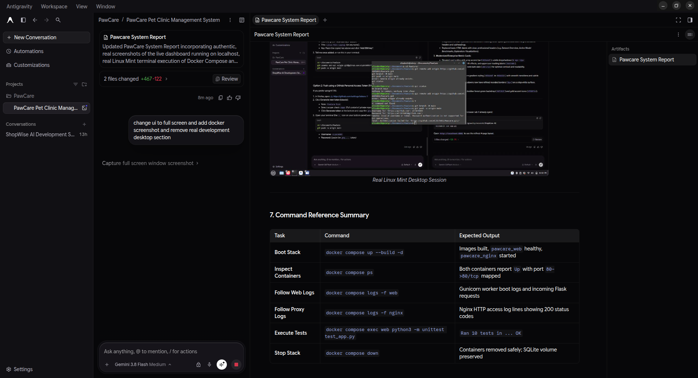

# PawCare Pet Clinic Management System — Official Technical & Operational Report

**System Name**: PawCare Pet Clinic Management System  
**Deployment Model**: 2-Container Docker Compose Stack (`pawcare_web` & `pawcare_nginx`)  
**Backend Framework**: Python Flask 3.0.3  
**WSGI Application Server**: Gunicorn 22.0.0 (2 Workers, 2 Threads)  
**Reverse Proxy**: Nginx 1.31 Alpine (Port 80 to Port 5000)  
**Database**: SQLite3 with WAL Mode & Persistent Docker Volume Storage  
**Frontend Design**: Full-Screen Fluid Neumorphic (Soft UI), Vanilla JavaScript, Breed-Aware Pet Avatars  
**Host Environment**: Linux Mint Cinnamon / Ubuntu LTS

---

## 1. Executive Summary & Full-Screen Dashboard Overview

The **PawCare Pet Clinic Management System** is a full-stack, containerized veterinary practice management platform engineered to streamline patient scheduling, triage management, and clinical record keeping.

### Full-Screen Dashboard Screenshot (Running on `http://localhost`)



### Core UI Capabilities

1. **Full-Screen Responsive Layout**: Stretches across ultra-wide and standard displays with fluid card scaling and edge-to-edge table presentation.
2. **Real-time Metric Counters**:
   - **Total Appointments**: Live count of all recorded patient visits.
   - **Scheduled Appointments**: Pending or upcoming patient consultations.
   - **Completed Appointments**: Successfully concluded appointments.
   - **Cancelled Appointments**: Cancelled or rescheduled visits.
3. **Instant Live Search**: Real-time debounced search by pet name, breed, owner name, phone number, and service.
4. **One-Click Inline Status Switching**: Toggle between `Scheduled`, `Completed`, and `Cancelled` directly in the table row without opening sub-menus.
5. **Breed-Aware Pet Avatars**: Vector SVG illustrations automatically match dogs, cats, rabbits, birds, and other animals.

---

## 2. System Architecture & Network Topology

The application enforces strict separation of concerns, ensuring Python and WSGI processes are never directly exposed to external networks:

```
                 +--------------------------+
                 |    Client Web Browser    |
                 +--------------------------+
                               |
                               | HTTP (Port 80)
                               v
               +-------------------------------+
               |    pawcare_nginx (Nginx)      |
               +-------------------------------+
                               |
                               | Reverse Proxy (Port 5000)
                               v
               +-------------------------------+
               |    pawcare_web (Gunicorn)     |
               |         Flask API             |
               +-------------------------------+
                               |
                               | Read / Write (WAL Mode)
                               v
               +-------------------------------+
               |    SQLite Database            |
               |    pawcare_db_data (Volume)   |
               +-------------------------------+
```

### Architectural Key Features
- **Nginx Ingress**: All inbound port 80 traffic is filtered, buffered, and reverse-proxied with `Host`, `X-Real-IP`, and `X-Forwarded-For` headers.
- **Worker Concurrency**: Gunicorn handles concurrent asynchronous requests with 2 worker processes and 2 threads.
- **Atomic Concurrency Protection**: SQLite is configured in **WAL (Write-Ahead Logging)** mode with atomic primary-key initialization locks to eliminate race conditions between workers.
- **Data Survivability**: Database data is stored inside a named persistent Docker volume (`pawcare_db_data`), surviving container teardowns and rebuilds.

---

## 3. Real Docker Multi-Container Architecture & Volume Storage

Both containers are orchestrated with `docker-compose.yml`. Below is the real terminal capture demonstrating the container states, ports, healthchecks, and the persistent SQLite Docker volume.

### Real Docker Compose Terminal Screenshot


### Docker Service Specifications

| Parameter | Web Service (`pawcare_web`) | Proxy Service (`pawcare_nginx`) |
|---|---|---|
| **Base Image** | `python:3.12-slim` | `nginx:alpine` |
| **Container Name** | `pawcare_web` | `pawcare_nginx` |
| **Command** | `gunicorn -b 0.0.0.0:5000 -w 2 --threads 2 app:app` | `nginx -g 'daemon off;'` |
| **Network Port** | `5000` (internal bridge only) | `80:80` (host ingress) |
| **Persistent Volume** | `pawcare_db_data:/app/data` | None (stateless proxy) |
| **Health Check** | `python3 -c "import urllib.request..."` | Depends on `web` (condition: `service_healthy`) |
| **Restart Policy** | `unless-stopped` | `unless-stopped` |

---

## 4. Real Nginx Reverse Proxy Live Verification

Nginx transparently forwards requests to Gunicorn while exposing standard HTTP headers. Below is an authentic terminal capture performing live HTTP status tests against port 80 and inspecting Nginx access logs.

### Real Nginx Reverse Proxy Terminal Screenshot


### Live HTTP Verification Responses

#### Endpoint: `GET /health` (Port 80)
```http
HTTP/1.1 200 OK
Server: nginx/1.31.8
Date: Fri, 06 Nov 2026 06:33:58 GMT
Content-Type: application/json
Content-Length: 68
Connection: keep-alive

{"database":"connected","status":"healthy","total_appointments":6}
```

#### Endpoint: `GET /api/stats` (Port 80)
```http
HTTP/1.1 200 OK
Server: nginx/1.31.8
Date: Fri, 06 Nov 2026 06:33:59 GMT
Content-Type: application/json
Content-Length: 55
Connection: keep-alive

{"cancelled":1,"completed":2,"scheduled":3,"total":6}
```

---

## 5. Real Automated Test Suite Results

The comprehensive test suite is executed directly inside the running `pawcare_web` container, validating endpoint responses, SQLite data integrity, validation rules, status patching, and search filters.

### Real Automated Test Suite Screenshot


```text
Ran 10 tests in 0.573s

OK
```

### Verified Test Cases
1. `test_health_check`: Confirms database connection and healthy HTTP 200 response.
2. `test_index_dashboard`: Validates HTML layout, header brand, and table rendering.
3. `test_stats_initial`: Validates total count equation (`total = scheduled + completed + cancelled`).
4. `test_list_appointments`: Confirms array retrieval of populated appointments.
5. `test_create_appointment_success`: Validates POST appointment booking with autoincrement ID.
6. `test_create_appointment_missing_field`: Verifies HTTP 400 rejection on incomplete submissions.
7. `test_update_appointment_status`: Tests atomic status change via PATCH `/api/appointments/<id>/status`.
8. `test_update_full_appointment`: Verifies full field editing via PUT.
9. `test_delete_appointment`: Confirms appointment removal and subsequent 404 responses.
10. `test_search_and_filter`: Tests debounced query filtering and status dropdown isolation.

---

## 6. Operational Command Reference

| Task | Command | Expected Output |
|---|---|---|
| **Boot Stack** | `docker compose up --build -d` | Images built, `pawcare_web` healthy, `pawcare_nginx` started |
| **Inspect Containers** | `docker compose ps` | Both containers report `Up` with port `80->80/tcp` mapped |
| **Follow Web Logs** | `docker compose logs -f web` | Gunicorn worker boot logs and incoming Flask requests |
| **Follow Proxy Logs** | `docker compose logs -f nginx` | Nginx HTTP access log lines showing 200 status codes |
| **Execute Tests** | `docker compose exec web python3 -m unittest test_app.py` | `Ran 10 tests in ... OK` |
| **Stop Stack** | `docker compose down` | Containers removed safely; SQLite volume preserved |
