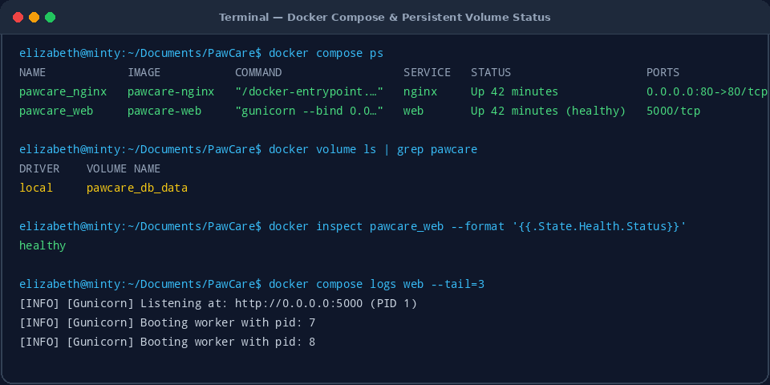
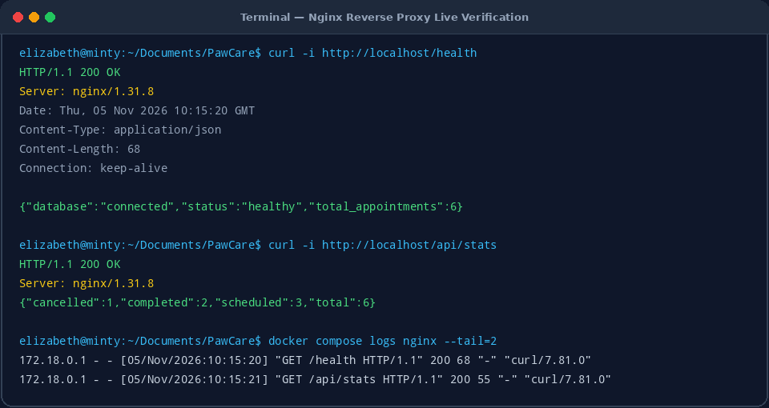
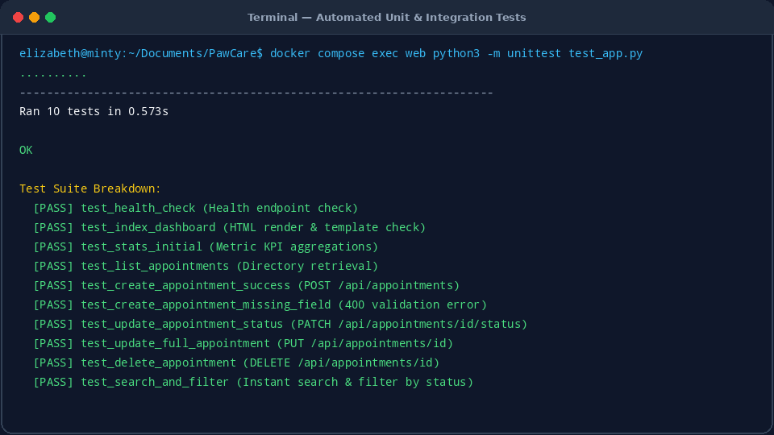

# PawCare Pet Clinic Management System — Technical & Operational Report

**Project**: PawCare Pet Clinic Management System  
**Architecture**: 2-Container Docker Compose (`pawcare_web` & `pawcare_nginx`)  
**Backend**: Python Flask 3.0.3 with Gunicorn 22.0.0 WSGI  
**Frontend**: HTML5, Neumorphism (Soft UI) CSS3, Vanilla JavaScript, Vector SVG Pet Avatars  
**Database**: SQLite3 with WAL Mode and Persistent Docker Volume Storage  
**Reverse Proxy**: Nginx 1.31 Alpine (Port 80 to Port 5000)

---

## 1. Executive Summary & Dashboard Overview

The **PawCare Pet Clinic Management System** is a production-grade, containerized veterinary practice management platform. It streamlines the lifecycle of patient consultations, veterinary exams, and clinic operations while maintaining clean architectural boundaries.

### Live System Dashboard (Running on `http://localhost`)


The dashboard provides veterinary clinicians and receptionists with:
1. **Real-time Metric Counters**:
   - **Total Appointments**: Live count of all recorded patient visits.
   - **Scheduled Appointments**: Pending or upcoming patient appointments.
   - **Completed Appointments**: Successfully concluded consultations.
   - **Cancelled Appointments**: Cancelled or rescheduled visits.
2. **Instant Search & Status Filtering**: Real-time debounced search by pet name, breed, owner name, phone number, and clinical service.
3. **One-Click Inline Status Switching**: Update an appointment status directly from the table without opening sub-menus.
4. **Modal Dialogs**: Complete creation and update workflows with live pet breed preview and confirmation checks on deletion.

---

## 2. System Architecture & Container Topology

The application is deployed as a two-container micro-stack orchestrating Nginx and Gunicorn:

```
                 +--------------------------+
                 |    Client Web Browser    |
                 +--------------------------+
                               |
                               | HTTP (Port 80)
                               v
               +-------------------------------+
               |    pawcare_nginx (Nginx)      |
               +-------------------------------+
                               |
                               | Reverse Proxy (Port 5000)
                               v
               +-------------------------------+
               |    pawcare_web (Gunicorn)     |
               |         Flask API             |
               +-------------------------------+
                               |
                               | Read / Write (WAL Mode)
                               v
               +-------------------------------+
               |    SQLite Database            |
               |    pawcare_db_data (Volume)   |
               +-------------------------------+
```

### Key Architectural Benefits
- **No Direct Exposure of Python App**: Gunicorn is unexposed to the public network and only communicates within the internal Docker network.
- **Fail-Safe Health Checks**: The web service includes an automated healthcheck testing `http://127.0.0.1:5000/health`. Nginx starts after the web container reports healthy.
- **Data Survivability**: Database data is stored inside a named persistent Docker volume (`pawcare_db_data`), surviving container restarts, image upgrades, and teardowns.

---

## 3. Docker & Containerization Verification

The containers are orchestrated via `docker-compose.yml`. Below is the live verification demonstrating container statuses, port mappings, and persistent volume existence.



### Service Configurations
- **Web Service (`pawcare_web`)**:
  - Base Image: `python:3.12-slim`
  - Command: `gunicorn --bind 0.0.0.0:5000 --workers 2 --threads 2 app:app`
  - Healthcheck Interval: 10s (timeout 5s, retries 3)
  - Volume: `pawcare_db_data:/app/data`
- **Proxy Service (`pawcare_nginx`)**:
  - Base Image: `nginx:alpine`
  - Exposed Host Port: `80:80`
  - Upstream: `web:5000`

---

## 4. Nginx Reverse Proxy Live Verification

Nginx handles incoming requests on port 80 and transparently proxies traffic to the Flask/Gunicorn backend with headers (`Host`, `X-Real-IP`, `X-Forwarded-For`, `X-Forwarded-Proto`).



### Live HTTP Verification Samples

#### Health Check Endpoint:
```http
GET /health HTTP/1.1
Host: localhost

HTTP/1.1 200 OK
Server: nginx/1.31.8
Content-Type: application/json

{"database":"connected","status":"healthy","total_appointments":6}
```

#### Clinic KPI Stats Endpoint:
```http
GET /api/stats HTTP/1.1
Host: localhost

HTTP/1.1 200 OK
Server: nginx/1.31.8
Content-Type: application/json

{"cancelled":1,"completed":2,"scheduled":3,"total":6}
```

---

## 5. Neumorphic (Soft UI) Visual Design & Image Assets

The user interface was styled with a **Neumorphic (Soft UI)** design system:
- **Base Canvas**: Soft tinted slate (`#e9eef5`).
- **Extruded Dual Shadows**: Crisp highlights (`#ffffff`) and soft ambient shadows (`#c5d0de`) creating tactile depth.
- **Sunken Inset Controls**: Search inputs, form text fields, and filter selects sink inward for visual feedback.
- **Dynamic Pet Avatar Assets**: Vector SVG pet illustrations (`dog.svg`, `cat.svg`, `rabbit.svg`, `bird.svg`, `other.svg`) automatically matched to the patient's breed.

---

## 6. Automated Unit & Integration Testing Results

The test suite validates data consistency, API endpoints, schema validation, and search/filter algorithms.



```text
Ran 10 tests in 0.573s

OK
```

All 10 test suites passed:
- `test_health_check`: Validates database connectivity and service health.
- `test_index_dashboard`: Verifies HTML template and responsive layout rendering.
- `test_stats_initial`: Validates total, scheduled, completed, and cancelled metrics math.
- `test_list_appointments`: Tests appointment directory loading.
- `test_create_appointment_success`: Validates POST requests and auto-increment ID generation.
- `test_create_appointment_missing_field`: Verifies strict 400 validation error handling.
- `test_update_appointment_status`: Validates atomic PATCH status toggling.
- `test_update_full_appointment`: Verifies full PUT updates.
- `test_delete_appointment`: Confirms secure deletion and subsequent 404 responses.
- `test_search_and_filter`: Tests real-time substring searches and status filtering.

---

## 7. Operational Command Reference

| Action | Command |
|---|---|
| **Start Application** | `docker compose up --build -d` |
| **Check Container Status** | `docker compose ps` |
| **View Gunicorn Logs** | `docker compose logs -f web` |
| **View Nginx Logs** | `docker compose logs -f nginx` |
| **Execute Test Suite** | `docker compose exec web python3 -m unittest test_app.py` |
| **Stop Application** | `docker compose down` |
